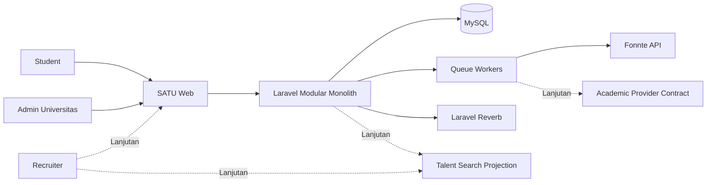

# Technical Architecture SATU

## 1. Status

Target architecture adalah Laravel 13 modular monolith, Inertia v3 React, MySQL, queue workers, Laravel Reverb, dan provider adapters. Runtime saat ini masih parsial. Issue implementasi wajib memeriksa code sebelum menyatakan komponen tersedia.

Kontrak target 14 Oktober 2026 melayani satu universitas dengan Mahasiswa dan
Admin Universitas sebagai role inti. Penggabungan admin platform/kampus serta
penetapan konteks universitas diterapkan bertahap: U02 menyediakan fondasi,
U03 menyatukan sumber izin admin, U04 membatasi aktivasi dan konteks mahasiswa,
dan U05 menyediakan UI admin terpadu.
U06 menyediakan regresi perjalanan dua admin dan worker MySQL lokal terisolasi
untuk konflik serta pemulihan logical. Pembuktian itu bukan perubahan model
tenant, pemberian akses baru atau persetujuan deployment production.
Data historis tidak digabung atau dihapus. Scope dan kewenangan mengikuti
[PRODUCT](../../PRODUCT.md) serta [PRD](../product/PRD.md#matriks-kewenangan-inti).

## 2. System Context

Database adalah source of truth. Reverb hanya mengirim authorized deltas setelah commit. Provider response tidak boleh langsung menjadi domain truth tanpa validation dan persistence.

## 3. Modular Boundaries

Gunakan framework directories yang ada. Business capability dipisahkan melalui model, Action, Policy, Form Request, query/projection class, Job, Event, dan Notification yang eksplisit:

- Identity dan Phone Verification
- Institution dan Roster
- Profile dan Skills
- Projects, Matching, dan Teams
- Workspace
- Contributions dan Portfolio
- Gamification
- Campus Operations dan Inclusion
- Talent
- Academic Integration
- Notification dan Audit

Jangan membuat base architecture folder baru tanpa approval.

## 4. Request dan Page Flow

Read model navigasi T02 mempertahankan route existing. Discovery menerima
`view=opportunities|mine` yang divalidasi Form Request dan dibawa ke pagination.
Pilihan mine memakai ownership atau membership tim aktif, dalam institusi
terverifikasi yang sama; filter privat tetap mengikuti hubungan yang diizinkan.
Beranda membaca revisi milik pengguna, tugas assigned, pengajuan pending dan
proyek pemilik/anggota secara institution-scoped untuk tindakan berikutnya.
Policy tetap diperiksa sebelum memberi tindakan resource. Tidak memproyeksikan
bukti, catatan internal atau sinyal inklusi, dan tidak melakukan mutasi pada GET.
Pengelompokan fitur lanjutan tidak mengubah event consumer atau scheduler.

- Laravel named route menerima request.
- Form Request menangani validation dan request-level authorization.
- Policy melindungi setiap resource serta tenant boundary.
- Action menjalankan business transition dalam transaction.
- Event domain dipublikasikan after commit.
- Inertia mengirim initial page state dan command result.
- React memakai Wayfinder, bukan hardcoded backend URL.

## 5. Identity dan Authorization

T06 mempertahankan Actions transisi tim dan lock proyek sebagai titik
serialisasi penerimaan, penolakan, penarikan, serta undangan. Hash revisi
memeriksa pengajuan dan kebutuhan tim terbaru, bukan timestamp saja. Membership,
kapasitas, terminal state pengajuan, audit, serta penyelesaian tawaran pending
lain tersimpan dalam transaksi yang sama. Notifikasi canonical database
diantrekan setelah commit; event perubahan kapasitas T05 tetap dipertahankan.
Serializer proyek memeriksa Policy, membatasi antrean kepada pemilik dan riwayat
pribadi kepada pemohon, serta memakai eager load karya berizin maksimal tiga
per pemohon. Query tidak memuat bukti privat profil atau kontribusi. Workspace
tetap memakai TaskPolicy terhadap membership aktif dan lifecycle aktual.

Profil kemampuan T03 memakai GET baca-saja serta Form Request, Policy dan
Actions profil existing. Pemilihan membership mahasiswa dibagi antara shell,
onboarding, Beranda serta editor agar konteks verified tidak tertukar oleh
request pending yang lebih baru. Editor menyimpan informasi, kemampuan/minat
dan jadwal dalam satu transaksi. Revision hash snapshot terhitung membaca
relasi profil; pembaruan memeriksa hash dalam lock profil untuk mendeteksi
konflik walaupun timestamp hanya presisi detik. Klien lama tetap memakai
kontrak timestamp existing. Metadata bukti baru divalidasi sebelum Action
menyimpan, tetap privat, dan tidak menjadi input status verifikasi.

Pengajuan afiliasi manual dapat menyimpan fakultas, program studi, dan angkatan
masuk sebagai draft akademik terenkripsi melalui Action terpisah. Draft bukan
profil, tidak disertakan pada proyeksi admin, dan ringkasan aktivasi hanya
mengembalikan nilainya kepada mahasiswa pemilik setelah verifikasi. Form
Profil kemampuan memakai nilai itu sebagai default ketika belum ada profil;
Action pembuatan profil memakai nilai draft hanya untuk field yang tidak
dikirim dan menghapus draft dalam transaksi yang sama. Data profil lain tetap
tidak tersimpan sebelum mahasiswa menyimpan profil.

Laravel Fortify tetap menjadi frontend-agnostic auth backend, tetapi username field dikustomisasi menjadi private `username`. Registrasi dan recovery adalah application-owned flow berbasis verified phone dan OTP. Fortify email verification/reset flow dinonaktifkan setelah rebaseline selesai.

Phone dinormalisasi ke E.164 memakai `propaganistas/laravel-phone`. SATU menghasilkan OTP, menyimpan hash, expiry, attempt count, consumed state, purpose, serta audit-safe metadata. Fonnte hanya mengirim pesan.

Authorization memakai native Laravel Policies dan Gates. `spatie/laravel-permission` tidak menjadi baseline karena role SATU berasal dari institution/recruiter membership dan active tenant context, bukan global user role. Keputusan ini dapat ditinjau ulang hanya jika permission matrix berkembang di luar relationship-based Policy tanpa mengorbankan tenant isolation.

## 6. Tenant Context

U02 menyediakan `ResolveConfiguredUniversity` untuk satu universitas yang
ditentukan melalui `config('university.slug')`. `SATU_UNIVERSITY_SLUG` pada
deployment menunjuk `universitas-teknologi-yogyakarta` (UTY); tidak menyimpan
ID numerik tetap. Resolver membaca institusi aktual setiap pemanggilan,
memeriksa identitas, keberadaan dan
status aktif; konfigurasi hilang, tidak aktif atau salah menolak operasi dan
tidak memilih institusi pertama atau membership terbaru. Konteks resource,
route serta membership berizin harus cocok dengan universitas yang ditetapkan.
Nama atau ID universitas kiriman browser bukan sumber kewenangan.

Pemakai runtime U02 adalah inventaris `university:inspect`, provisioning
`university:provision-admin` serta seeder UTY lokal. U03 menghubungkan resolver
dengan sumber izin membership admin UTY, workspace, Policy dan pemetaan
deployment. Resolver bukan pengganti Policy. U04 memakai resolver pada aktivasi
dan konteks mahasiswa. Inventaris hanya
membaca jumlah resource serta ID akun yang memerlukan pemetaan, tidak
memindahkan data atau mengeluarkan kredensial/nomor WhatsApp.

Institution scope wajib diterapkan pada query, route binding, Policy, job
payload, cache key, storage path, export, notification, broadcast channel, dan
observability context. Parameter `{institution}` existing tetap diautorisasi
sampai pemetaan route U03 selesai. Admin Universitas memiliki membership
berizin pada universitas sasaran, dengan satu sumber role untuk workspace dan
operasi inti. Flag `is_platform_admin` tidak menjadi bypass dalam target;
pemetaan alias, undangan dan consumer existing dilakukan eksplisit pada U03.

Runtime U03 memakai `User::universityAdminMembership` yang membaca membership
verified dengan `verified_at` pada UTY aktif, bukan snapshot relasi, urutan
membership terbaru atau flag platform. `campus_admin` tetap identifier teknis
storage/workspace untuk kompatibilitas, bukan sumber role kedua. Context
Policy menolak membership admin kampus lain; middleware administrasi menolak
route campus/platform/university yang tidak diotorisasi. U04 mengikat context
mahasiswa pada universitas yang dikonfigurasi, tanpa menggabungkan data lama.

`ResolveStudentMembership` membaca membership mahasiswa pada universitas
konfigurasi, tanpa urutan terbaru atau institusi pertama. `StudentActivationSummary`
mengirim nama/ID universitas, status minimum, verified-phone boolean, kebutuhan
pembaruan roster dan profil yang memang diizinkan kepada pemilik saja.
Tidak mengirim daftar kampus atau profil tenant lama; public portfolio tidak
menerima shared auth/onboarding. GET hanya membaca sumber aktual.

Request NIM memakai Form Request dengan ID optional untuk kompatibilitas;
jika dikirim, ID harus sama dengan konfigurasi. Controller memilih universitas
server. Policy serta Actions affiliation/membership memeriksa sumber dan
status, lalu mengunci universitas sebelum user/nomor/membership. Suspended
ditolak di bawah lock; exact match tetap memakai nomor verified dan roster.
Create profile mengunci universitas dan mengotorisasi ulang sebelum menulis.
Context membership di dalam transaksi memakai locking read, bukan snapshot
lama. Bukti concurrency MySQL tetap U06, bukan klaim dari tes SQLite.

Beranda, profil, penelusuran/editor proyek, daftar kontribusi, portofolio serta
peringkat membaca target yang sama; URL/resource kampus lain ditolak Policy
walaupun mahasiswa pernah memiliki membership verified di sana. Riwayat tidak
dihapus atau dipindahkan, dan operasi hak data serta penarikan consent existing
tidak diubah. Onboarding memeriksa afiliasi sebelum profil. Draft berada pada
memori sesi akun, bukan localStorage. Perubahan konteks atau hasil POST belum
pasti menahan mutasi sampai pembacaan status, tanpa retry POST otomatis.

GET platform lama hanya redirect berotorisasi. Approval/suspension institusi
baru ditutup sampai level Action. Katalog dan versi pencocokan memakai sumber
izin admin UTY. `university.advanced_administration.gamification` default false,
sehingga penggabungan tidak otomatis memberi hak lanjutan. Sejak 17 Oktober
2026, workspace hanya Student dan CampusAdmin. Rute/UI perekrut dan admin
platform terpisah dihapus. Policy organisasi serta entitlement perekrut selalu
menolak; konfigurasi perekrut lama tidak dapat menghidupkannya kembali. Model
historis tidak menjadi sumber izin. Nilai `campus_admin` tetap alias Admin Universitas.

Provisioning admin pertama berlangsung melalui operasi deployment terkontrol.
Implementasi U02 hanya CLI, dengan dry run default dan `--apply` eksplisit.
Action memeriksa identitas masuk serta WhatsApp terverifikasi, mengunci
institusi/akun/nomor/membership, dan menyimpan membership beserta audit dalam
satu transaksi. Konflik membership atau flag admin platform lama memerlukan
pemetaan U03; bootstrap tidak menimpa atau mengaktifkan ulang akun lama.
Membership sementara memakai alias `campus_admin`, bukan hak platform global.
Admin berikutnya menerima undangan WhatsApp, dan tindakan pengelolaan admin
menggunakan autentikasi ulang, transaksi serta audit sesuai risiko. Pencabutan
admin aktif terakhir dan validasi kontribusi sendiri ditolak. Keputusan tim
tetap mengikuti pemilik proyek dan membership. Akses bantuan serta analitik
restricted memerlukan izin dan gate terpisah dari role admin.

Sebelum transisi, runtime memilih workspace platform/kampus secara terpisah
dan konteks kampus melalui membership serta parameter route. Kontrak baru
memerlukan inventaris query, job, cache, storage, export, broadcast dan jalur
lama, dry run pemetaan akun, backup serta pemulihan; tidak menggabungkan data
institusi lain atau memutus consumer inti melalui perubahan konfigurasi saja.

U03 mengunci row universitas sebelum memetakan, mengelola status atau menerima
undangan admin. Revision status mencakup atribut membership dan audit terakhir
agar status kembali sama pada detik yang sama tetap dikenali sebagai sumber
berbeda. Admin terakhir tidak ditangguhkan, termasuk sebelum penghapusan akun
mandiri. Undangan pending dari admin yang dicabut ditutup dalam transaksi;
worker WhatsApp dan notifikasi reviewer memeriksa izin aktual sebelum kirim.
Riwayat keputusan approval tetap menjadi sumber consumer portofolio, bukan
hak reviewer hari ini. Scheduler dan post-commit consumer inti tetap tersedia.

Di dalam transaksi, universitas, membership admin dan epoch audit memakai
locking read agar keputusan tidak mengandalkan snapshot SELECT lama.
Pemeriksaan admin lain juga memakai locking read, bukan aggregate/exists
yang dapat membaca snapshot transaksi sebelumnya. Penghapusan akun mengunci
universitas sebelum akun/membership, memuat ulang akun dan memakai retry
deadlock. Admin verified tidak dihapus saat konteks universitas tidak aktif.

## 7. Realtime

T07 memakai SHA-256 snapshot metadata tugas dan assignment, tanpa kolom baru.
Kelima command yang mengubah tugas existing mewajibkan `expected_revision`,
mengunci proyek lalu tugas, memeriksa Policy ulang, dan menolak konflik 409
sebelum audit/event. Serializer memuat assignment secara eager. Pilihan
`scope=all|mine|unassigned` serta `task` diterapkan sebelum pagination dalam
proyek yang diotorisasi. Beranda membawa ID tugas aktual lewat Wayfinder.

Bukti tanpa pesan memakai endpoint GET daftar berpagination yang diautorisasi
TaskPolicy dan `WorkspaceEvidenceQuery`. Unggahan serta penghapusan memancarkan
`workspace.attachment.changed` setelah commit pada private channel existing.
Delta hanya memicu pembacaan database dan tidak memuat nama berkas, isi pesan,
path, checksum atau bukti. Klien mempertahankan draft/revisi asli ketika data
berubah, menahan mutasi saat hasil tidak pasti, dan tidak melakukan POST retry
otomatis. Subscription dilepas saat akses tidak tersedia.

Versi delta tugas memakai revisi snapshot, dengan waktu kejadian berpresisi
mikrodetik. Delta duplikat, terlambat, tenant salah atau operasi di luar allowlist
diabaikan. Koneksi awal dan reconnect membaca snapshot terbaru. Penyimpanan
berkas yang berhasil dalam transaksi bertingkat mendaftarkan cleanup jika
transaksi luar dibatalkan, tanpa menghapus berkas dari retry transaksi yang
akhirnya berhasil. Klien mengirim tenggat lokal sebagai ISO UTC; label waktu
mengikuti zona waktu perangkat.

- Private channel untuk resource-scoped delta.
- Presence channel hanya untuk active team member yang berwenang.
- Event payload memakai allowlist, version, resource ID, occurred-at, dan actor display projection bila perlu.
- Client menerima delta, tetapi reconciliation selalu membaca snapshot database.
- Duplicate, out-of-order, reconnect, permission loss, dan stale state diuji.

## 8. Matching dan Inclusion

Matching service menerima normalized input, versioned weights, dan menghasilkan component scores serta explanation untuk empat dimensi yang disetujui.

T05 memakai event perubahan input setelah commit, Action permintaan persisten
dan job pada antrean default. Job membawa ID institusi/kandidat/permintaan
serta revision, membaca ulang Policy dan sumber, lalu menulis batch dalam
transaksi ber-lock. Retry revision yang sama tidak menggandakan hasil; revision
lama dibuang. Scheduler merekonsiliasi antrean tertunda serta versi/expiry,
bukan GET. Pembacaan membandingkan digest sumber aktual sebelum memberi hasil.
Kebijakan v2 wajib eksplisit pada versi immutable baru; konfigurasi production
default tidak aktif. Kebutuhan waktu yang belum tersedia dan konektivitas
tetap netral, tanpa provider jaringan atau analisis pesan.

Inclusion engine membaca collaboration graph projection, bukan message content. Engine dan UI berada di balik Laravel Pennant. Synthetic dan real activation dipisahkan. Signal diserialisasi hanya melalui restricted projection dan selalu menuju human review.

## 9. Gamification

XP ledger append-only memakai unique source key untuk idempotency. Badge evaluator membaca approved versioned rules. Leaderboard projection dibangun per institution dan semester, menyimpan denominator, active-member rule version, cohort suppression, tie method, serta computed-at. Inclusion tidak masuk pipeline.

## 10. Talent Search

Talent memakai recruiter-safe projection terpisah dari domain model dan private portfolio. Laravel Scout database engine menjadi baseline search tanpa external infrastructure. Organization membership, verification, entitlement, candidate visibility, saved item, serta contact request tetap transactionally authorized.

## 11. Integrations dan Notifications

`WhatsAppGateway` memiliki Fonnte implementation dan fake. Outbox/job menangani delivery, retry, provider message ID, callback, reconciliation, masking, serta idempotency. Gunakan Laravel HTTP Client, Notifications, Queue, dan scheduler. Jangan memakai unofficial Fonnte package.

`AcademicGateway` memiliki sandbox implementation dan provider implementation di masa depan. Sync job membawa internal idempotency key, mapping version, external reference, status history, retry class, serta reconciliation metadata.

## 12. Libraries

- Existing: Laravel Fortify, Inertia, Wayfinder, Reverb/Echo, Tailwind.
- Approved fit-first: Laravel Pennant, Laravel Scout database engine, `propaganistas/laravel-phone`, `spatie/simple-excel`, `@tanstack/react-table`, Recharts, Cytoscape.js, dan `@dnd-kit/react`.
- Setiap issue menyebut install command, compatibility, license review, dan alasan. Dependency baru tetap memerlukan approval sebagaimana project rule.

## Kontribusi Individual T08

Submit, revisi dan review mengunci proyek sebelum kontribusi. Penghapusan
attachment serta mutasi tugas memakai lock proyek yang sama. Token
`ContributionSnapshot` mendeteksi pointer versi, status, referensi tugas dan
sumber berkas (termasuk soft-delete) tanpa bergantung pada timestamp detik.
Token wajib pada Form Request dan Action; konflik menghasilkan HTTP 409.
Filesystem diperiksa sebelum submit/approval. Tidak ada schema baru.

Review approved memanggil `SyncApprovedPortfolioEntry` dalam transaksi
keputusan. Karya privat, audit, dan keputusan sukses atau rollback bersama.
Judul berasal dari klaim individual; summary adalah ringkasan yang dapat
dipilih untuk dibagikan. Event after-commit serta listener portofolio/XP/badge
existing tetap dipertahankan; replay sync idempotent dan memeriksa reviewer,
versi kebijakan, institusi serta versi sumber. Tidak mengaktifkan modul baru.

Daftar bukti revisi adalah pengganti lengkap bila key evidence dikirim; key
yang tidak dikirim mempertahankan rujukan aktif sebelumnya. Endpoint link
tetap append dan membentuk versi baru. Tidak menghapus versi/review/file lama.
Antrean tidak memuat draft atau keputusan sendiri. Notifikasi keputusan
mengarah ke sumber berizin tanpa reason/note privat.

Klien mengunci command ganda, mempertahankan draft, dan memeriksa hasil belum
pasti melalui GET. Data baru tidak mengganti sumber editor tanpa keputusan
eksplisit. Create yang hasilnya belum pasti meminta pemeriksaan daftar di tab
baru dan konfirmasi manual sebelum retry, bukan retry otomatis atau jaminan
idempotensi antar-request create. Pengiriman tidak mengklaim sukses pada 422.

## 13. Operations

Queue harus memiliki retry class, timeout, backoff, idempotency, dead-letter handling, dan dashboard/runbook. Log memakai request/tenant/job correlation tanpa phone, OTP, token, message body, private evidence, atau inclusion detail. Backup, restore, provider degradation, and incident response diuji sebelum production gate.

## T09: Dukungan dan Evaluasi Terbatas

Action bantuan memakai lock pemilik lalu proyek tawaran bila relevan lalu permintaan, memeriksa ulang Policy dan source. Form Request membatasi command dan data; route institusi memakai scoped binding; React memakai Wayfinder. GET tidak membuat permintaan, consent, event atau ringkasan persisten. Tidak menambah provider atau background consumer.

Ringkasan operasional menghitung pengguna unik terverifikasi saat snapshot, bukan kohort impact retrospektif. Event keanggotaan menunjukkan pernah bergabung, bukan kerja bersama. Audit submit menjadi sumber pengajuan kontribusi, bukan updated_at; pengakuan membutuhkan contribution approved, versi, review dan karya privat yang konsisten. Data yang tidak dapat dibuktikan tetap unavailable. Dataset manifest dan gate per institusi membatasi pencampuran synthetic/nyata; tidak menerbitkan agregat ke mahasiswa/perekrut.

## T10: Pembuktian Perjalanan Inti

Demo publik memakai dataset TypeScript lokal dan tidak memanggil command bisnis.
Peta lazy dimuat hanya saat disclosure pelengkap dibuka. Tur tetap GET melalui
Wayfinder, tanpa perubahan penanda sudah dilihat atau consent.

`CoreJourneyDemoSeeder` menolak lingkungan selain testing, SQLite selain
`:memory:`, manifest tidak sesuai serta database yang sudah berisi aktor.
Suite `check-core-journey.php` mengganti koneksi PDO dengan memori kosong untuk
dua perjalanan independen, menjalankan migrasi serta Actions aplikasi existing.
Aktor operator dan identitas terverifikasi adalah prasyarat fixture, bukan
bukti registrasi/OTP atau delivery undangan. Exact match dan pemulihan manual
afiliasi, profil, peluang, pencocokan, penerimaan, tugas, bukti, revisi,
approval, visibility dan withdrawal dijalankan, bukan ditanam sebagai hasil.

Queue database memakai koneksi uji; worker membaca job setelah commit.
Broadcast memakai null dan HTTP provider di-fake dengan stray requests ditolak.
Restore logical SQLite serta checksum berkas synthetic diuji di tempat
terpisah. Ini tidak membuktikan row lock MySQL, socket Reverb nyata, backup
MySQL produksi, OTP provider atau dampak pilot. Runner lintas platform
`check-core-release.cjs` menjadi tes bisnis CI selain static checks.
